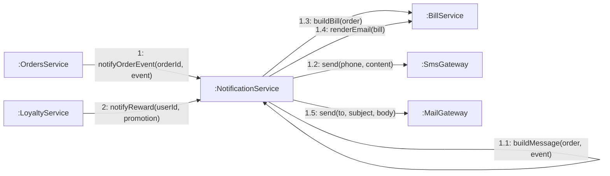

# 08 · Collaboration 13 — Gửi thông báo cho khách (BR28, BR38)

Phục vụ UC18, UC22, UC34, UC35 (và UC73 khi rút tiền xong). Cùng nội dung với `05-sequence/Sequence-14-ThongBao.md`, nhìn theo liên kết đối tượng. Thông điệp 1 do `OrdersService` gửi mỗi khi đơn có sự kiện (đặt đơn, thanh toán thành công, nước xong, nhận xong).

| Số | Ghi chú |
|---|---|
| 1.1 | Tạo nội dung SMS theo `event`: `ORDER_CREATED`, `PAYMENT_SUCCESS`, `ORDER_READY`, `ORDER_COMPLETED` |
| 1.2 | Luôn gửi: SMS mock tới số điện thoại (bắt buộc), thực chất chỉ ghi log. Với `PAYMENT_SUCCESS`, SMS chỉ một dòng ngắn (mã đơn + mã giao dịch) |
| 1.3 và 1.4 | Chỉ khi `event = PAYMENT_SUCCESS` và khách có email: dựng hóa đơn và email HTML theo mẫu `02-use_case/MauHoaDon.md` |
| 1.5 | Chỉ gửi khi khách có email: email thật qua SMTP. Với `PAYMENT_SUCCESS`, thân thư là hóa đơn |
| 2 | Thông báo mã thưởng `REWARD_ISSUED`: `LoyaltyService` gọi khi cấp mã thưởng (BR40). Cũng gửi SMS và email nếu có, chi tiết ở `Sequence-14-ThongBao`; không gắn với đơn nào nên `Notification.orderId` để trống |
| Cả hai kênh | Mỗi lần gửi lưu một dòng `Notification`; lỗi chỉ ghi `FAILED`, không làm hỏng đơn |
