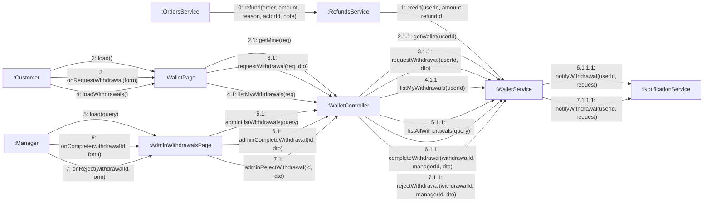

# 08 · Collaboration 14 — Ví hoàn tiền và rút tiền (UC71, UC72, UC73)

Cùng nội dung với `05-sequence/Sequence-15-ViHoanTien.md`. Số 1 cộng tiền hoàn vào ví, 2 xem ví, 3 gửi yêu cầu rút, 4 xem yêu cầu của mình, 5 quản lý xem danh sách yêu cầu, 6 hoàn tất, 7 từ chối.

| Số | UC | Ghi chú |
|---|---|---|
| 0 | UC38, UC74 | `OrdersService` gọi hoàn tiền khi hủy đơn đã trả tiền hoặc khi xử lý món không làm được |
| 1 | UC38, UC74 | Tiền hoàn luôn vào ví, không trả về cổng thanh toán (BR43) |
| 2.1.1 | UC71 | Số dư và lịch sử biến động ví |
| 3.1.1 | UC72 | Số tiền từ 10.000 đến số dư. Trừ ví ngay (giữ chỗ). Thiếu thông tin nhận trả 400, vượt số dư trả 422 (BR44) |
| 6.1.1 | UC73 | Chỉ khi `PENDING`, bắt buộc mã giao dịch chuyển thủ công, báo khách |
| 7.1.1 | UC73 | Chỉ khi `PENDING`, bắt buộc lý do, trả lại ví và báo khách |
