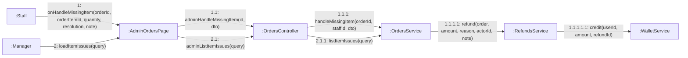

# 08 · Collaboration 15 — Nhân viên xử lý món không làm được (UC74)

Cùng nội dung với `05-sequence/Sequence-16-XuLyMonKhongLamDuoc.md`. Số 1 nhân viên xử lý món không làm được, 2 quản lý xem lại các lần xử lý.

| Số | Ghi chú |
|---|---|
| 1.1.1 | Lưu `ItemIssue` kèm nhân viên và lý do (bắt buộc từ 5 ký tự). Đơn phải ở `PAID`, `PREPARING` hoặc `READY`, chưa giao (BR45) |
| 1.1.1.1 và 1.1.1.1.1 | Chỉ khi chọn hoàn tiền vào ví: hoàn đơn giá ly × số ly, cộng vào ví. Chọn đổi món thì không có hai bước này |
| 2.1.1 | Chỉ `MANAGER` xem danh sách các lần xử lý |
